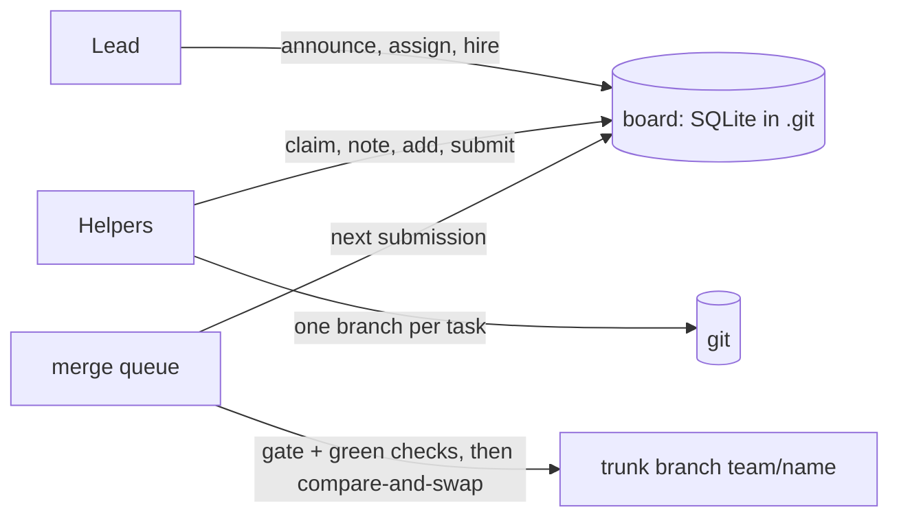

# team-build

A Claude Code plugin that builds a large software project with a lead agent and a crew of helper agents. The agents coordinate only through a shared SQL board and git. A merge queue lands only work that passes the checks.

Site: https://swiftugandan.github.io/team-build/

## How it works

You and the lead agree on milestones. Each milestone has an acceptance check: a command that exits 0 only when the capability works, end to end. The lead builds a walking skeleton where every check runs and fails. Then it hires helpers, each in its own git worktree, and steers them through the board.



- **The board** holds orders, assignments, notes, the task tree and the merge requests. Helpers never message each other.
- **Captains** post a plan and a difficulty verdict for their milestone and split it into tasks. Any helper can split a task that is too big.
- **The merge queue** is the only writer of the trunk branch. It refuses a submission that conflicts, fails the gate, breaks a green milestone, or changes a protected path such as an acceptance check.
- **The lead** checks verdicts against real throughput, moves helpers to the open work, and keeps the crew full until every milestone is green.

The design comes from two posts on claude.dev: [Safely scaling multi-agent teams with Claude Fable 5.2](https://claude.dev/blog/safely-scaling-multi-agent-teams-with-fable-5-2/), where 1,000 agents proved Fermat's Last Theorem in Lean through a SQL database and git, and [How the Claude Code team thinks about verification](https://claude.dev/blog/how-the-claude-code-team-thinks-about-verification/). [docs/design.md](docs/design.md) maps each practice from those posts to its mechanism here.

## Install

In Claude Code:

```
/plugin marketplace add swiftugandan/team-build
/plugin install team-build@team-build
```

Or from a shell:

```
claude plugin marketplace add swiftugandan/team-build
claude plugin install team-build@team-build
```

It needs git, Python 3.9 or later, and macOS or Linux. Every agent runs on the machine that holds the repo.

## Use

Open Claude Code in the repo you want to build, then:

```
/team-build:team-build docs/prd.md
```

Give it a spec or PRD. If you have none, it asks you to write one first. You approve the milestones and their acceptance checks before any helper starts. After that, the lead asks you only to change a milestone or a check, to drop a milestone, or when the budget is spent.

The skill runs only when you type it, because a run spawns many agents. Each helper is a full agent session, so cost grows with the number of helpers and the hours they work. Put a number after the spec to set the crew size (default 6), for example `/team-build:team-build docs/prd.md 8`.

During a run:

- the trunk branch `team/<name>` holds the landed work, in `.team-build/trunk`;
- each helper works in `.team-build/<name>`;
- the board is `.git/team-build/board.db`.

Your own checkout and branch stay as they are. When the run ends, the lead reports the trunk branch and asks before it merges or pushes anything.

## Develop

```
make test    # board self-test in a temp repo (12 checks)
make lint    # ruff, shellcheck, manifest JSON
make serve   # the site on http://localhost:8000
make og      # render site/og.png from design/og.html
```

- `plugin/skills/team-build/SKILL.md`: the lead's steps.
- `plugin/skills/team-build/HELPER.md`: the helper's loop and the captain's duties.
- `plugin/skills/team-build/scripts/board.py`: the board and the merge queue (standard library only).
- `docs/design.md`: the design record, the test record and the limits.
- `site/`: the marketing page, deployed to GitHub Pages from `main`.

## License

MIT
